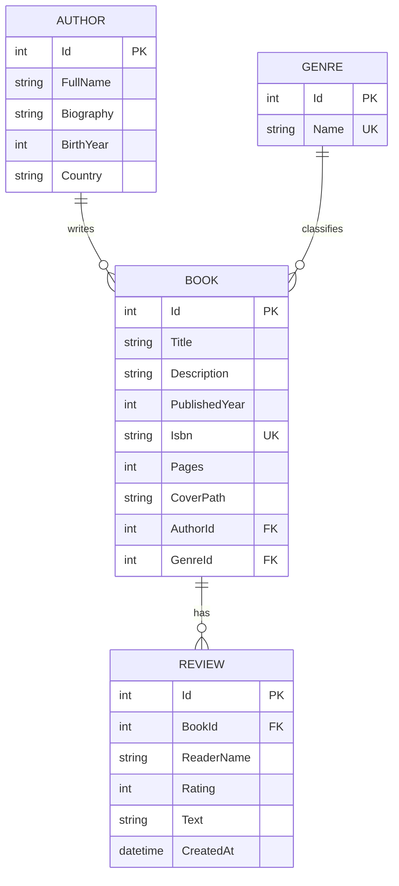

# Bookshelf — специфікація

## Опис

Bookshelf — вебзастосунок для каталогу бібліотеки. У ньому зберігаються автори, жанри та книги, а читачі можуть залишати відгуки з оцінкою. До кожної книги можна завантажити обкладинку.

## Сутності

**Author** (автор)

- Id
- FullName — повне ім'я, обов'язкове
- Biography — біографія, необов'язкова
- BirthYear — рік народження, необов'язковий
- Country — країна, необов'язкова

**Genre** (жанр)

- Id
- Name — назва, обов'язкова й унікальна

**Book** (книга)

- Id
- Title — назва, обов'язкова
- Description — опис, необов'язковий
- PublishedYear — рік видання
- Isbn — обов'язковий і унікальний
- Pages — кількість сторінок
- CoverPath — шлях до файлу обкладинки, необов'язковий
- AuthorId, GenreId — посилання на автора і жанр

**Review** (відгук)

- Id
- BookId — посилання на книгу
- ReaderName — ім'я читача, обов'язкове
- Rating — оцінка від 1 до 5
- Text — текст відгуку, необов'язковий
- CreatedAt — дата створення, проставляється автоматично

Зв'язки: в автора може бути багато книг, у жанру теж; у книги може бути багато відгуків.

## ERD

## Функціональні вимоги

1. Для авторів, жанрів, книг і відгуків можна переглянути список і окремий запис, а також створити, змінити й видалити запис.
2. На сторінці автора і жанру показуються їхні книги.
3. Список книг можна фільтрувати за жанром і автором та шукати за назвою.
4. На сторінці книги показуються її дані, відгуки, середня оцінка та форма для нового відгуку.
5. До книги можна завантажити обкладинку. Нова обкладинка замінює стару, і старий файл видаляється. Якщо обкладинки немає, показується заглушка.
6. Коли книгу видаляють, разом з нею видаляються її відгуки і файл обкладинки.

## Правила валідації

- Оцінка у відгуку має бути від 1 до 5.
- Рік видання не може бути більшим за поточний.
- ISBN має бути правильним ISBN-10 або ISBN-13 і не повторюватися серед книг.
- Кількість сторінок має бути більше нуля.
- Назва жанру не повторюється (без урахування регістру).
- Обов'язкові текстові поля не можуть бути порожніми.
- Книга має посилатися на існуючого автора і жанр, а відгук — на існуючу книгу.
- Обкладинка — файл JPG, PNG або WEBP розміром до 5 МБ.
- Автора чи жанр, у яких є книги, видалити не можна.
